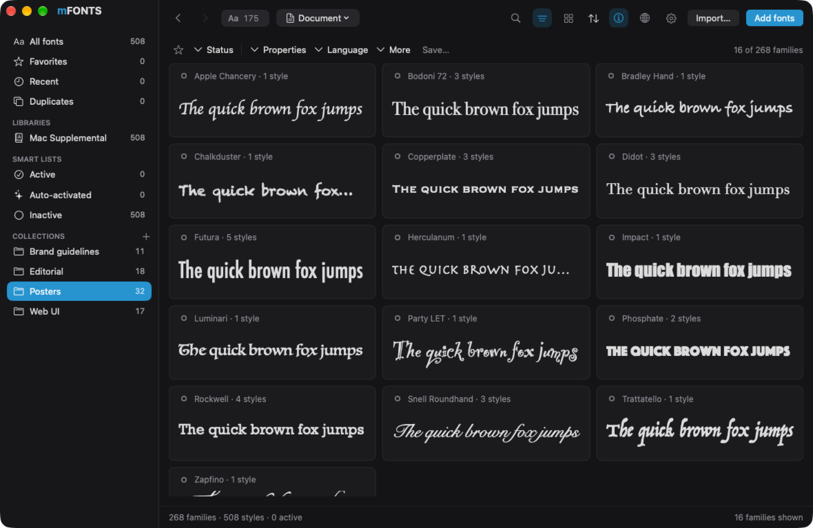

# mFONTS

## About

**mFONTS** is a font manager for macOS: libraries, collections, tags, favorites, activation, live preview, and import of Right Fonts libraries, collections and preferences (read-only, fonts are referenced, never copied). Inspired by Right Fonts, not affiliated with it.

- Authors: Starbudweiser & Claude Code (Anthropic) — MIT License, © 2026 Starbudweiser.
- Provided as is, without warranty. Part of the **DESKTOP MAC TOOLKIT**.
- In the app: menu **mFONTS ▸ About mFONTS**.

## Build
`./build_app.sh` (install locally) · `DEV=1 ./build_app.sh` (dev edition, bundle id `fr.stephan.mfonts.dev`). Design: `maquettes/`, architecture: `ARCHITECTURE.md`.

## Support / Soutenir

This app is free. If it is useful to you, you can support the project (optional, no reward expected): [GitHub Sponsors](https://github.com/sponsors/starbudweiser).

Cette appli est gratuite. Si elle vous est utile, vous pouvez soutenir le projet (facultatif, sans contrepartie) : [GitHub Sponsors](https://github.com/sponsors/starbudweiser).
